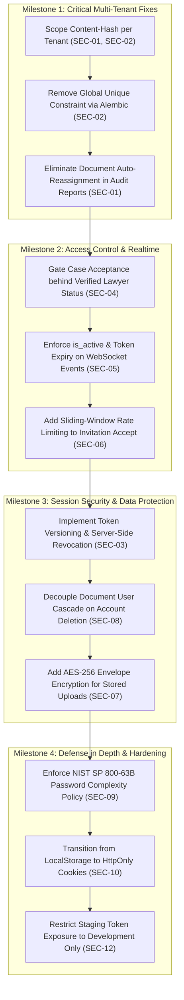

# Phase 6A: Advanced Data Security and Authentication Audit

**Project:** JURISCAN-AI
**Audit Phase:** Phase 6A — Advanced Data Security, Multi-Tenant Isolation & Authentication Audit; Phase 6B.1 remediation for SEC-01 / SEC-02; Phase 6B.2 remediation for SEC-04 / SEC-05 / SEC-06; Phase 6B.3 remediation for SEC-03
**Date:** 2026-11-10 (audit); 2026-11-14 (Phase 6B.1 and Phase 6B.2 remediation); 2026-11-15 (Phase 6B.3 remediation)
**Branch:** `feature/realtime-messaging` (Merged with `main` PR #9 / PR #10)
**Target Environment:** FastAPI Backend, SQLAlchemy + PostgreSQL 16 (Alembic migration head `f5a6b7c8d9e0` after Phase 6B.3), WebSockets & WebRTC Signaling, React + TypeScript Frontend
**Methodology:** Full-codebase white-box architectural review, static data-flow analysis, authorization path tracing, cryptographic validation, and multi-tenant isolation analysis across all four system roles (**Individual User**, **Lawyer**, **Company**, and **Admin**).

---

## 1. Executive Summary

A comprehensive security audit of JURISCAN-AI was conducted following the merge of the company workspace features (PR #10) and WebRTC voice calling infrastructure. The audit examined all layers of authentication, authorization, multi-tenant isolation, realtime communications, document storage, cryptographic guarantees, and frontend session management.

### Key Audit Finding
While the core authentication mechanisms implemented in Phase 5 remain intact (sliding-window IP rate limiting, constant-time login verification via dummy hashing, disabled API docs in production, and safe registration race handling), the introduction of multi-tenant company workspaces and global document deduplication introduced **critical tenant isolation vulnerabilities**. Most notably:
1. **Global Content-Hash Deduplication Seizure [CRITICAL]**: When an individual user uploads a confidential document, and subsequently any company user uploads an identical document or the user is invited to a company, the individual's document is automatically and permanently annexed into the company workspace, granting all company members access to private legal documents.
2. **Cross-Tenant Upload Denial of Service & Existence Oracle [HIGH]**: A database-level `unique=True` constraint on `documents.content_hash` across the entire database prevents distinct companies or users from analyzing identical legal documents (e.g., standard NDAs or leases) and acts as an existence oracle.
3. **Unvetted Lawyer Access [HIGH]**: Any unverified user registering as a lawyer is immediately granted full access to the client case marketplace and can accept cases to view confidential client evidence without any professional license verification or administrative approval.
4. **Stateless Session Replay Window [HIGH]** (resolved in Phase 6B.3): Authentication tokens had a fixed 7-day TTL with no revocation list, no server-side session tracking, and no token invalidation upon user logout. Tokens now carry a per-user version that is bumped on logout/password change and checked on every HTTP and WebSocket authentication.
5. **Realtime WebSocket Expiration & Suspension Bypass [HIGH]**: Long-lived WebSockets do not verify token expiration after the initial handshake, and per-event authorization checks do not verify `User.is_active`, allowing deactivated users to maintain live messaging and voice calling.

### Findings Severity Summary

| ID | Title | Severity | Category | CWE / OWASP | Status |
|---|---|---|---|---|---|
| **SEC-01** | Cross-Tenant Document Seizure via Content-Hash Deduplication | **CRITICAL** | Authorization / Multi-Tenancy | CWE-284 / CWE-639 (A01:2021) | **Resolved (Phase 6B.1)** |
| **SEC-02** | Cross-Tenant Upload Denial of Service & Existence Oracle | **HIGH** | Data Isolation / Availability | CWE-400 / CWE-203 (A04:2021) | **Resolved (Phase 6B.1)** |
| **SEC-03** | Stateless Session Architecture Lacks Revocation or Logout Invalidation | **HIGH** | Authentication / Session | CWE-613 / CWE-384 (A07:2021) | **Resolved (Phase 6B.3)** |
| **SEC-04** | Unvetted Lawyer Role Grants Instant Access to Confidential Cases | **HIGH** | Authorization / RBAC | CWE-285 / CWE-306 (A01:2021) | **Resolved (Phase 6B.2)** |
| **SEC-05** | WebSocket Realtime Connections Bypass Token Expiry & Account Suspension | **HIGH** | Realtime Security | CWE-672 / CWE-863 (A01:2021) | **Resolved (Phase 6B.2)** |
| **SEC-06** | Missing Rate Limiting on Company Invitation Acceptance | **MEDIUM** | Authentication | CWE-307 (A07:2021) | **Resolved (Phase 6B.2)** |
| **SEC-07** | Plaintext Document Storage & Absence of Encryption at Rest | **MEDIUM** | Cryptography / Data Protection | CWE-311 / CWE-312 (A02:2021) | Open |
| **SEC-08** | User Account Deletion Cascades and Destroys Corporate Documents | **MEDIUM** | Data Integrity | CWE-404 (A04:2021) | Open |
| **SEC-09** | Weak Password Complexity Policy & Missing Multi-Factor Authentication | **LOW** | Authentication | CWE-521 / CWE-308 (A07:2021) | Open |
| **SEC-10** | Session Token Exposure in Browser LocalStorage | **LOW** | Frontend Security | CWE-922 (A05:2021) | Open |
| **SEC-11** | Missing Platform Administrative Controls & Unenforced Admin Role | **LOW** | RBAC / Governance | CWE-284 (A01:2021) | Open |
| **SEC-12** | Raw Invitation Token Disclosure in Staging API Responses | **INFORMATIONAL** | Information Disclosure | CWE-200 (A05:2021) | Open |

### Phase 6B.1 Remediation Outcome

SEC-01 and SEC-02 are **resolved** on branch `feature/realtime-messaging` (uncommitted Phase 6B.1 work at the time of writing). Deduplication and uniqueness are now tenant-scoped, personal documents are never reassigned to a company, and document retrieval/deletion respects the caller's current tenant.

### Phase 6B.2 Remediation Outcome

SEC-04, SEC-05, and SEC-06 are **resolved** on branch `feature/realtime-messaging` (uncommitted Phase 6B.2 work at the time of writing). Lawyer actions that expose confidential case resources now require `verification_status == "VERIFIED"`; both WebSocket transports revalidate token expiry and `User.is_active` per event and on a periodic watchdog; and company invitation acceptance is rate limited per client IP.

### Phase 6B.3 Remediation Outcome

SEC-03 is **resolved** on branch `feature/realtime-messaging` (uncommitted Phase 6B.3 work at the time of writing). Tokens now carry a per-user `token_version`; logout and password change atomically increment it; and HTTP plus both WebSocket transports reject outdated versions immediately. The remaining session-hardening gap is the lack of short-lived access tokens with rotating refresh tokens, and there is still no password-reset flow. SEC-07 through SEC-12 remain open and are tracked in [Section 8](#8-remaining-risks-and-open-findings).

---

## 2. Verification of Phase 5 Security Baseline

All security enhancements established during Phase 5 (commit `2948d0b`) were verified to remain fully operational following the PR #10 merge:

1. **Sliding-Window IP Rate Limiting (`backend/app/core/ratelimit.py`)**:
   - Both `/auth/login` and `/auth/register` enforce per-client IP sliding-window limits (default 10 requests / 60 seconds).
   - In-memory key tracking limits memory footprint with automated cleanup of expired windows.
   - Code verification: `backend/app/api/auth.py:57-74` (Dependencies intact).
2. **Login Timing Equalization (`backend/app/api/auth.py`)**:
   - Failed logins for nonexistent email accounts run a full PBKDF2 cycle against `_DUMMY_HASH` (240,000 iterations).
   - Prevents enumeration of registered email addresses via timing discrepancies.
   - Code verification: `backend/app/api/auth.py:41-44, 169` (Intact).
3. **Disabled Interactive API Documentation in Production/Staging**:
   - `docs_url`, `redoc_url`, and `openapi_url` evaluate to `None` when `APP_ENV` is `"production"` or `"staging"`.
   - Code verification: `backend/main.py:75, 82-84` (Intact).
4. **Document Deletion Role Validation (`_ensure_can_delete`)**:
   - Verified that company `VIEWER` users cannot delete documents.
   - Non-owner deletions require `can_manage_company_documents` (`COMPANY_ADMIN` or `MANAGER`).
   - Code verification: `backend/app/api/documents.py:316-335, 487` (Intact).
5. **Registration Concurrency Race Handling**:
   - Catches `IntegrityError` upon concurrent email/username collisions and returns HTTP 409 Conflict (`registration_conflict`) rather than an unhandled HTTP 500 error.
   - Code verification: `backend/app/api/auth.py:144-153` (Intact).

---

## 2A. Phase 6B.1 Remediation Verification (SEC-01 / SEC-02)

### Scoped content-hash deduplication
- `backend/app/services/processing.py:process_upload` now queries:
  - company uploads: `Document.company_id == company_id AND content_hash == hash`;
  - personal uploads: `Document.user_id == user.id AND company_id IS NULL AND content_hash == hash`.
- The old branch that reassigned `existing.company_id` was removed. Identical content in another tenant creates a new document instead of seizing an existing one.
- `IntegrityError` race handling repeats the same scoped lookup, so a race can only report a duplicate inside the caller's own tenant.

### Scoped uniqueness migration
- New migration `backend/alembic/versions/4a299ac7e3ed_scope_document_content_hash_uniqueness.py`:
  - inspects and drops the legacy global unique index/constraint (`ix_documents_content_hash` or `documents_content_hash_key`);
  - recreates a non-unique `content_hash` index;
  - adds partial unique indexes `ix_documents_company_content_hash` on `(company_id, content_hash) WHERE company_id IS NOT NULL` and `ix_documents_user_personal_content_hash` on `(user_id, content_hash) WHERE company_id IS NULL`;
  - logs (without deleting) any same-scope duplicate groups found before creating the constraints;
  - downgrade refuses with an actionable error if cross-tenant duplicates exist, preventing silent data loss.
- Model indexes in `backend/app/models/document.py` mirror the migration for `create_all` (tests).

### Audit-report backfill removed
- `backend/app/api/audit_reports.py` now filters strictly by `Document.company_id == user.company_id`; `_company_user_ids`, the `OR` scope, and all automatic `company_id` writes were deleted. Joining a company cannot annex personal documents.

### Retrieval and deletion hardening
- `backend/app/api/documents.py` combines personal ownership with current-company scope: personal documents (`company_id IS NULL`) remain readable after joining or leaving; company documents are readable only while the caller is in that company. Former members lose access to company documents they uploaded.
- `get_analysis` uses the same readable-document conditions.
- Bulk delete (`delete_all_documents`) is scoped to the current company for managers and to personal documents only for everyone else; it no longer deletes company documents via `user_id` or documents from a previous company.
- Single-document deletion requires the document to be personal-owned or in the caller's current company (and manager role for others' company documents).
- Company uploads no longer reuse an existing company by name; a company account without membership gets a new workspace, preventing tenant takeover by name collision.

### Regression tests
- `backend/tests/test_document_isolation.py` covers same-user duplicate rejection, cross-user and cross-company identical uploads, tenant-scoped 409 details, personal-document privacy after joining, company-document revocation after leaving, bulk-delete scoping, and unauthorized document/analysis/report access.
- `backend/tests/test_migrations.py` covers scoped index creation, same-scope duplicate rejection at the DB level, cross-tenant duplicate preservation, missing-legacy-index tolerance, downgrade/upgrade, and `alembic check` model consistency.

### Verification results
- Backend: `python -m pytest` -> **336 passed, 1 skipped** (337 collected).
- Migration: `alembic upgrade head` + `alembic check` on a fresh SQLite database -> `No new upgrade operations detected`.
- Frontend: `npm test` -> **46 passed**; `npm run lint` -> 0 errors (4 pre-existing fast-refresh warnings); `npm run build` -> success.
- `git diff --check` -> clean.

---

## 2B. Phase 6B.2 Remediation Verification (SEC-04 / SEC-05 / SEC-06)

### Verified-lawyer gate
- `backend/app/api/deps.py` adds `lawyer_verification_status`, `ensure_verified_lawyer`, `require_verified_lawyer`, and `VerifiedLawyerUser`.
- `accept_case`, `request_case_info`, the lawyer branch of `create_case_clarification`, and the call REST/signaling paths now require a `VERIFIED` `LawyerProfile`.
- Missing, `UNVERIFIED`, `PENDING`, and `REJECTED` profiles receive HTTP 403 with `lawyer_verification_required`.
- Realtime and call authorization also recheck verification for the **assigned lawyer**; a lawyer acting as the case owner is not blocked by their own verification status.
- Unverified lawyers can still register, update their profile, and submit for verification, preserving the existing workflow.

### WebSocket session lifecycle
- Both `/cases/{case_id}/ws` and `/cases/{case_id}/calls/ws` retain the session token after the handshake.
- Every inbound event revalidates the token signature/expiry and `User.is_active`; failures send `{"type": "error", "code": "session_invalid"}` and close with code `4401`.
- A 15-second watchdog revalidates idle connections and closes expired/suspended sessions with code `4401`.
- Case-party and lawyer-verification authorization remain checked per event; failures send `not_authorized` and close with code `4403`.
- Watchdog tasks are cancelled and connections are removed in `finally`, preserving existing disconnect and peer-notification behavior.

### Company invitation rate limiting
- New settings: `company_invitation_rate_limit_max_requests` (default 10) and `company_invitation_rate_limit_window_seconds` (default 60).
- `backend/app/api/company.py` adds a per-client-IP `SlidingWindowRateLimiter` and the `invitation_accept_rate_limit` dependency on `POST /company/invitations/accept`.
- Exhausted budgets return HTTP 429 `rate_limited` with `Retry-After`; the limiter remains memory-bounded by the existing 65,536-key cap.
- The test suite disables the limiter with `COMPANY_INVITATION_RATE_LIMIT_MAX_REQUESTS=0`; `backend/tests/test_rate_limit.py` resets and re-enables it explicitly.

### Regression tests
- `backend/tests/test_cases.py`: four parameterized cases cover `UNVERIFIED`, `PENDING`, `REJECTED`, and missing profiles for accept, request-info, and clarification creation.
- `backend/tests/test_realtime.py`: suspended account, expired token, and revoked verification are rejected on an existing socket.
- `backend/tests/test_calls.py`: unverified assigned lawyer REST rejection, suspended/expired call socket, case-authorization recheck per event, and revoked verification.
- `backend/tests/test_rate_limit.py`: invitation acceptance returns 429 with `Retry-After`.
- Existing verified-lawyer workspace, messaging, and WebRTC signaling tests remain green.

### Verification results
- Backend: `python -m pytest -o addopts="" -q` -> **349 passed, 1 skipped** (350 collected), 1 warning.
- Migration: fresh SQLite `alembic upgrade head` + `alembic check` -> single head `4a299ac7e3ed`; `No new upgrade operations detected`.
- Frontend: `npm test` -> **46 passed**; `npm run lint` -> 0 errors (4 pre-existing fast-refresh warnings); `npm run build` -> success (2014 modules transformed).
- `git diff --check` -> clean (Git LF-to-CRLF warnings only).

---

## 2C. Phase 6B.3 Remediation Verification (SEC-03)

### Token versioning and migration
- `backend/app/models/user.py` adds `token_version`, an `Integer` column with `default=1`, `server_default=text("1")`, and `nullable=False`.
- `backend/alembic/versions/f5a6b7c8d9e0_add_user_token_version.py` (down revision `4a299ac7e3ed`) adds the column with a server default, so existing active and disabled users are backfilled to version `1` without a data rewrite.
- Downgrading to `4a299ac7e3ed` drops only the new column; user rows are retained. A subsequent upgrade safely restores version `1`.
- `backend/tests/test_migrations.py::test_token_version_migration_backfills_existing_users` exercises upgrade -> insert legacy users -> upgrade head -> downgrade -> upgrade head.

### Token issuance and validation
- `backend/app/core/security.py` embeds `"ver": token_version` in every newly signed token and exposes `AccessTokenClaims` through `decode_access_token_claims`.
- `decode_access_token` remains as an `int | None` compatibility wrapper, but tokens without a positive `ver` claim are rejected. Operators should expect one forced re-login for tokens issued before this release.
- `backend/app/api/deps.py::_user_from_token` requires `user.token_version == claims.token_version` in addition to signature, expiry, and `is_active` checks, so a version bump invalidates every token for that user immediately.
- All issuance paths pass the current version: `_token_response` in `backend/app/api/auth.py` and company invitation acceptance in `backend/app/api/company.py`. Invitation acceptance intentionally does not revoke the accepting user's existing sessions.
- Request logging still records only method, path, status, and duration. No `Authorization` header, request body, or raw token is logged by the application or by Phase 6B.3 error paths.

### Logout, password change, and session revocation
- `POST /api/auth/logout` (204) requires a currently valid bearer token and calls `revoke_user_sessions`.
- `POST /api/auth/change-password` (204) verifies `current_password`, updates the hash, and revokes all sessions. An incorrect current password returns `401` with `invalid_current_password`; the endpoint is rate limited by `auth_rate_limit`.
- `backend/app/services/users.py::revoke_user_sessions` performs an atomic `UPDATE users SET token_version = token_version + 1` and commits, avoiding read-modify-write races between concurrent logouts.
- Logout and password change revoke **all** sessions for the account, not only the calling device. Revoked tokens receive the same `401 invalid_token` response as malformed, expired, or version-mismatched tokens.
- There is no password-reset flow in the application today. Any future reset flow must call `revoke_user_sessions` as part of the reset transaction.

### WebSocket and frontend handling
- Messaging (`/cases/{case_id}/ws`) and call signaling (`/cases/{case_id}/calls/ws`) already revalidate the session per event and on the 15-second watchdog; both now reject version-mismatched tokens with `{"type": "error", "code": "session_invalid"}` and close code `4401`.
- The frontend `logout()` now awaits `POST /api/auth/logout` before discarding the local token, and `refresh()` clears the session on HTTP 401. A periodic 60-second revalidation and a visibility-change revalidation detect server-side revocation while the app is open.
- A failed logout request still clears local frontend state, but the server token remains valid until its expiry; this is a best-effort network limitation, not a trust-the-client design. The server remains the revocation authority.

### Regression tests
- `backend/tests/test_sessions.py`: token version claims, logout revocation of multiple sessions, revoked-token replay, password-change revocation and new-password login, and consistent rejection of malformed/expired/outdated/revoked tokens.
- `backend/tests/test_realtime.py` and `backend/tests/test_calls.py`: a version bump disconnects an already-open WebSocket with `session_invalid` / `4401`.
- `backend/tests/test_migrations.py`: token-version backfill and downgrade/re-upgrade safety.

### Verification results (2026-11-15)
- Backend: `python -m pytest -o addopts="" -q` -> **360 passed, 1 skipped**, 1 warning (~542s).
- Migration: fresh SQLite `alembic upgrade head` + `alembic check` -> single head `f5a6b7c8d9e0`; `No new upgrade operations detected`; downgrade to `4a299ac7e3ed` and re-upgrade to head succeeded.
- Frontend: `npm test` -> **46 passed**; `npm run lint` -> 0 errors (4 pre-existing fast-refresh warnings); `npm run build` -> success (2014 modules transformed).

---

## 3. In-Depth Vulnerability Analysis

---

### SEC-01: Cross-Tenant Document Seizure via Content-Hash Deduplication

* **Severity:** **CRITICAL** (CVSS:3.1/AV:N/AC:L/PR:L/UI:N/S:C/C:H/I:H/A:N — Base Score: 9.6)
* **Vulnerability Type:** Insecure Direct Object Reference (IDOR) / Multi-Tenant Isolation Breach (CWE-284, CWE-639; OWASP A01:2021)
* **Code Reference:**
  - `backend/app/services/processing.py:52-58`
  - `backend/app/api/audit_reports.py:48-74`

#### Vulnerability Mechanism
In `process_upload` (`backend/app/services/processing.py`), deduplication is performed against the global `Document` table using a SHA-256 content hash:
```python
existing = db.scalar(
    select(Document).where(Document.content_hash == content_hash)
)
if existing is not None:
    same_owner = existing.user_id == user.id
    same_company = (
        company_id is not None and existing.company_id == company_id
    )
    if company_id is not None and existing.company_id is None:
        # When a company user uploads a previously unassigned contract, attach it
        # to their company workspace so it automatically appears in audit reports.
        existing.company_id = company_id
        db.commit()
        db.refresh(existing)
        same_company = True
```
If an individual user (User A) uploads a private, sensitive legal document (such as a personal severance agreement, divorce settlement, or NDA), it is stored with `existing.user_id = User A` and `existing.company_id = None`.

If any authenticated user belonging to *any* company (Company B) subsequently uploads that identical document (or an identical template):
1. The backend detects `company_id is not None and existing.company_id is None`.
2. The backend **mutates the document's company assignment**: `existing.company_id = Company B.id` and commits the transaction to the database.
3. The backend sets `same_company = True`, which causes `_duplicate_conflict` to return the complete document details (`document_id`, `analysis_id`, `title`, and `filename`) to Company B's uploader.
4. **All members of Company B** (admins, managers, members, viewers) can now immediately view User A's document, read its extracted clauses, view risk findings, and download the full analysis report via `/company/audit-reports` and `/documents/{id}`.

A parallel issue exists in `backend/app/api/audit_reports.py:48-74`:
```python
def _company_scope_filter(db: DbSession, company_id: int):
    member_ids = _company_user_ids(db, company_id)
    if member_ids:
        return or_(
            Document.company_id == company_id,
            and_(Document.company_id.is_(None), Document.user_id.in_(member_ids)),
        )
...
for doc in docs:
    if doc.company_id is None:
        doc.company_id = company_id
        need_commit = True
if need_commit:
    db.commit()
```
When an individual user joins a company workspace via invitation, all personal documents previously uploaded by that user (where `company_id is None`) are matched by `_company_scope_filter` and are **silently re-assigned and permanently committed** to `doc.company_id = company_id`.

#### Attack Scenario
1. **Victim (Individual User Alice)** creates an account and uploads her personal employment dispute contract containing sensitive settlement terms and salary data.
2. **Attacker (Company Eve)** receives or obtains a copy of the standard contract form or drafts used by Alice's employer and uploads it to Eve's company workspace.
3. The backend matches `content_hash` and silently updates Alice's document record: `existing.company_id = Eve_Company.id`.
4. Eve calls `GET /api/documents/{document_id}` and `GET /api/company/audit-reports`. Eve now reads the complete text, analysis, and legal risk findings of Alice's document.
5. If Eve has the `COMPANY_ADMIN` or `MANAGER` role, Eve can call `DELETE /api/documents/{document_id}` or `DELETE /api/documents` and permanently destroy Alice's document.

#### Existing Protections
- None. The code explicitly re-assigns `existing.company_id` without verifying whether the original uploader consented or whether the uploader is the same individual.

#### Recommended Remediation
1. **Strictly Scope Deduplication**: Deduplication lookups must never cross tenant or user boundaries. Replace global hash matching with scope-constrained matching:
   ```python
   stmt = select(Document).where(Document.content_hash == content_hash)
   if company_id is not None:
       stmt = stmt.where(Document.company_id == company_id)
   else:
       stmt = stmt.where(Document.user_id == user.id, Document.company_id.is_(None))
   ```
2. **Eliminate Document Reassignment**: Never mutate `existing.company_id` during upload or audit listing. Documents uploaded in an individual context must remain in the individual's personal scope permanently unless explicitly migrated via an authenticated, user-confirmed action.
3. **Remove Automatic Backfill in Audit Reports**: Delete lines 66–73 and 94–96 in `backend/app/api/audit_reports.py`.

#### Remediation Status (Phase 6B.1)
**Resolved.** Deduplication is tenant-scoped and all `company_id` reassignment/backfill paths were removed. See Section 2A and `backend/tests/test_document_isolation.py::test_personal_document_stays_private_after_user_joins_company`.

---

### SEC-02: Multi-Tenant Denial of Service & Existence Oracle via Global Unique Content Hash

* **Severity:** **HIGH** (CVSS:3.1/AV:N/AC:L/PR:L/UI:N/S:U/C:L/I:N/A:H — Base Score: 7.1)
* **Vulnerability Type:** Resource Consumption Denial of Service / Information Disclosure (CWE-400, CWE-203; OWASP A04:2021, A05:2021)
* **Code Reference:**
  - `backend/app/models/document.py:34`
  - `backend/app/services/processing.py:47-50, 79-81`

#### Vulnerability Mechanism
`Document.content_hash` is declared with a global unique index:
```python
content_hash: Mapped[str | None] = mapped_column(
    String(64), unique=True, index=True, nullable=True
)
```
In `processing.py:process_upload`, when a second user or company uploads a document that matches an existing document owned by a different company:
```python
same_scope = same_owner or same_company
...
else:
    # Another user's (or company's) identical document is never touched or exposed.
    raise _duplicate_conflict(existing, user, same_scope=same_scope)
```
When `same_scope` is `False`, the backend raises an HTTP 409 Conflict with error code `document_already_exists`.

#### Impact & Exploitation
1. **Cross-Tenant Upload Denial of Service**:
   - If Company X uploads standard legal documents (e.g., standard Delaware General Corporation Law certificates, Y Combinator SAFE agreements, standard NVCA venture templates, or public government contracts), **no other company or user on the platform can ever upload or analyze that same document**.
   - A malicious actor can script the upload of thousands of standard, publicly available legal templates, thereby permanently preventing all other legitimate platform users from analyzing standard legal contracts.
2. **Confidentiality Side-Channel (Existence Oracle)**:
   - An adversary who suspects that a target company has signed a specific merger agreement draft or settlement document can upload candidate drafts.
   - If the upload succeeds (201 Created), the draft does not exist on the platform.
   - If the upload returns 409 Conflict, the adversary receives confirmation that a party has already uploaded and processed that specific document on the platform.

#### Recommended Remediation
1. **Remove Global Unique Constraint**: Remove `unique=True` from `content_hash` in `backend/app/models/document.py`.
2. **Add Composite Scope Constraint**: Replace the global unique index with partial composite indexes:
   - For company documents: `Index("ix_documents_company_content_hash", "company_id", "content_hash", unique=True, postgresql_where=text("company_id IS NOT NULL"))`
   - For individual documents: `Index("ix_documents_user_content_hash", "user_id", "content_hash", unique=True, postgresql_where=text("company_id IS NULL"))`
3. Generate an Alembic migration to drop the global unique constraint `documents_content_hash_key` and add the composite scoped unique indexes.

#### Remediation Status (Phase 6B.1)
**Resolved.** The global unique constraint is replaced by partial scoped unique indexes via migration `4a299ac7e3ed`; cross-tenant identical uploads now succeed and no longer act as an existence oracle. See Section 2A and `backend/tests/test_document_isolation.py::test_two_companies_can_upload_identical_documents_without_cross_access`.

---

### SEC-03: Stateless Session Architecture Lacks Revocation, Blocklist, or Logout Invalidation

* **Severity:** **HIGH** (CVSS:3.1/AV:N/AC:L/PR:L/UI:N/S:U/C:H/I:H/A:N — Base Score: 8.1)
* **Vulnerability Type:** Insufficient Session Expiration / Missing Revocation (CWE-613, CWE-384; OWASP A07:2021)
* **Code Reference:**
  - `backend/app/core/security.py:64-92`
  - `backend/app/api/deps.py:37-45, 144-150`
  - `frontend/src/context/AuthProvider.tsx:63-67`

#### Vulnerability Mechanism
Session tokens are generated as stateless HMAC-SHA256 signed JSON payloads:
```python
def create_access_token(user_id: int, *, secret: str, ttl_seconds: int) -> str:
    now = int(time.time())
    payload = {"v": _TOKEN_VERSION, "sub": user_id, "iat": now, "exp": now + ttl_seconds}
    segment = _b64encode(json.dumps(payload, separators=(",", ":")).encode("utf-8"))
    return f"{segment}.{_sign(segment, secret)}"
```
- **TTL**: Hardcoded default is 7 days (`settings.access_token_ttl_seconds = 604800`).
- **No Revocation Mechanism**: There is no server-side token identifier (`jti`), no session table, no Redis blocklist, and no user token version counter.
- **Client-Side Only Logout**: When a user clicks "Log out" in the frontend, `AuthProvider.tsx` calls `setAuthToken(null)`, which removes the token from browser `localStorage`. No request is dispatched to the backend, and the token remains fully active on the server until the 7-day expiration window elapses.
- **No Invalidation on Password Change or Compromise**: If an account's password is changed or an account is compromised, previously issued tokens continue to provide full API and WebSocket access for up to 168 hours.

#### Recommended Remediation
1. **Introduce Token Versioning or Session Tracking**:
   - Add a `token_version: int = mapped_column(Integer, default=1, nullable=False)` column to `users`.
   - Embed `"ver": user.token_version` into the signed session token payload.
   - When authenticating (`deps.py:_user_from_token`), verify `payload.get("ver") == user.token_version`.
   - On password change, logout, or session termination, increment `user.token_version = user.token_version + 1`, immediately invalidating all active sessions.
2. **Short-Lived Access Tokens + Refresh Token Architecture**:
   - Reduce access token TTL from 7 days to 15–30 minutes.
   - Implement single-use, rotating refresh tokens stored in database with explicit expiry and revocation capability.
3. **Implement Dedicated Logout Endpoint**: Provide `POST /api/auth/logout` to allow users and frontend clients to explicitly invalidate active sessions.

#### Remediation Status (Phase 6B.3) — Resolved

Token versioning and the dedicated logout endpoint are implemented:
- `User.token_version` is non-null with a safe server default (`1`) and is embedded as the signed `ver` claim.
- `_user_from_token` enforces exact version equality, so an atomic version bump invalidates every outstanding token for the account.
- `POST /api/auth/logout` revokes all sessions for the authenticated user; `POST /api/auth/change-password` verifies the current password, stores the new hash, and performs the same revocation.
- Both WebSocket transports reject revoked tokens on the next event and on the 15-second watchdog with `session_invalid` / `4401`.
- The frontend awaits server logout before clearing local state and revalidates the session periodically, clearing it on `401`.
- Regression coverage lives in `backend/tests/test_sessions.py`, `test_realtime.py`, `test_calls.py`, and `test_migrations.py`; see [Section 2C](#2c-phase-6b3-remediation-verification-sec-03).

The short-lived access token + rotating refresh token recommendation remains future work (see [Section 8](#8-remaining-risks-and-open-findings)). There is no password-reset flow yet; any future flow must call `revoke_user_sessions`.

---

### SEC-04: Unvetted Lawyer Role Grants Instant Access to Confidential Cases & Documents

* **Severity:** **HIGH** (CVSS:3.1/AV:N/AC:L/PR:N/UI:N/S:U/C:H/I:L/A:N — Base Score: 7.5)
* **Vulnerability Type:** Broken Access Control / Missing Authorization Gate (CWE-285, CWE-306; OWASP A01:2021)
* **Code Reference:**
  - `backend/app/api/auth.py:112, 124-139`
  - `backend/app/api/cases.py:470-520`
  - `backend/app/models/lawyer.py:47`

#### Vulnerability Mechanism
In `backend/app/api/auth.py:register`, any self-service registrant can choose `role="lawyer"`:
```python
if payload.role == "lawyer":
    profile = LawyerProfile(
        user_id=user.id,
        bar_registration_number=payload.bar_registration_number.strip() if payload.bar_registration_number else None,
        jurisdiction=payload.jurisdiction.strip() if payload.jurisdiction else None,
        ...
        verification_status="UNVERIFIED",
    )
```
As documented in `backend/app/models/lawyer.py:47`, "there is no automated or admin review flow yet, so this stays empty unless set."

However, in `backend/app/api/cases.py:accept_case`:
```python
@router.post("/cases/{case_id}/accept", response_model=CaseDetail)
def accept_case(db: DbSession, user: LawyerUser, case_id: int) -> dict:
```
The dependency `LawyerUser = Annotated[User, Depends(require_role("lawyer"))]` only checks `user.role == "lawyer"`. It **does not check `profile.verification_status == "VERIFIED"`**.

Consequently:
1. An unverified actor self-registers as a lawyer with arbitrary or fictitious bar numbers.
2. The actor calls `GET /api/cases` (accesses all client cases posted on the open marketplace).
3. The actor calls `POST /api/cases/{case_id}/accept` on any open case.
4. Once accepted, `_shared_document_ids` (`backend/app/api/documents.py:257-272`) permits the unverified user to call `GET /api/documents/{document_id}` and `GET /api/documents/{document_id}/report`.
5. The unverified actor gains complete access to the client's proprietary contracts, dispute summaries, clauses, and legal risk evaluations.

#### Recommended Remediation
1. **Enforce Verification Check on Privileged Lawyer Actions**:
   Modify `LawyerUser` or create a `VerifiedLawyerUser` dependency:
   ```python
   def require_verified_lawyer(user: CurrentUser, db: DbSession) -> User:
       if user.role != "lawyer":
           raise ForbiddenError("Action restricted to lawyer accounts.")
       profile = db.scalar(select(LawyerProfile).where(LawyerProfile.user_id == user.id))
       if profile is None or profile.verification_status != "VERIFIED":
           raise ForbiddenError(
               "Your lawyer account must be verified before accepting client cases.",
               code="lawyer_verification_required",
           )
       return user
   ```
2. Apply `VerifiedLawyerUser` to `accept_case`, `create_case_clarification`, and call initiation.

#### Remediation Status (Phase 6B.2)
**Resolved.** `VerifiedLawyerUser` and `ensure_verified_lawyer` now gate case acceptance, information requests, lawyer clarifications, and call participation. Unverified, pending, rejected, and profile-less lawyers receive HTTP 403 `lawyer_verification_required`. See Section 2B and `backend/tests/test_cases.py::test_unverified_lawyers_cannot_take_confidential_case_actions`.

---

### SEC-05: WebSocket Realtime Connections Bypass Token Expiry & Account Suspension

* **Severity:** **HIGH** (CVSS:3.1/AV:N/AC:L/PR:L/UI:N/S:U/C:H/I:H/A:L — Base Score: 8.3)
* **Vulnerability Type:** Broken Authorization / Improper Resource Lifecycle (CWE-672, CWE-863; OWASP A01:2021)
* **Code Reference:**
  - `backend/app/api/realtime.py:53-68, 120-127, 134-175`
  - `backend/app/api/calls.py:321-334, 385-446, 448-498`
  - `backend/app/services/realtime.py:13-35`

#### Vulnerability Mechanism
Both WebSocket endpoints (`/cases/{case_id}/ws` for workspace chat and `/cases/{case_id}/calls/ws` for WebRTC signaling) validate the session token exclusively during the initial auth handshake frame:
```python
is_auth, token = _extract_token(raw)
user = await run_in_threadpool(_authenticate, token)
if user is None:
    await websocket.close(code=WS_UNAUTHORIZED)
    return
```
Once the initial frame succeeds, the connection can stay open for hours or days.
1. **No Token Expiration Enforcement**: The WebSocket loop never checks whether `time.time() > exp`. A token that expires 2 minutes after connection establishment remains active indefinitely.
2. **Account Deactivation Bypass**: When messages are received in `case_workspace_socket`, `_handle_event` calls `persist_message`:
   ```python
   def persist_message(case_id: int, user_id: int, body: str) -> dict[str, Any] | None:
       db = SessionLocal()
       try:
           case = db.get(Case, case_id)
           if case is None or not is_case_party(case, user_id):
               return None
           message = CaseMessage(case_id=case_id, sender_user_id=user_id, body=body)
           db.add(message)
           ...
   ```
   Notice that `persist_message` checks `is_case_party(case, user_id)`. **It does not check whether `User.is_active` is `True`**.
   If an administrator detects an account takeover and deactivates the user (`user.is_active = False`), the active WebSocket connection is not closed and continues successfully sending messages, reading broadcasts, and participating in WebRTC voice calls.
3. **No Connection Limits or Rate Limits**: There are no quotas on the number of concurrent WebSocket connections a single user or IP can open, and no per-connection message rate limits, exposing the server to file descriptor exhaustion and database write floods.

#### Recommended Remediation
1. **Verify Active Account on Every Message**: Update `persist_message`, `load_authorized_case`, and `load_call_authorized_case` to query `User.is_active == True`:
   ```python
   user = db.get(User, user_id)
   if user is None or not user.is_active:
       return None
   ```
2. **Periodic Token Expiration & Re-authentication Check**: Store `expires_at` on the `Connection` object; verify on each ping/message event and terminate the socket with close code `4401` when expired.
3. **Connection Quotas**: Enforce a maximum of 5 concurrent WebSocket connections per user across workspaces.

#### Remediation Status (Phase 6B.2)
**Resolved for token expiry and account suspension.** Both WebSocket transports revalidate the session token and `User.is_active` on every inbound event and via a 15-second watchdog, closing with `4401` when invalid. Case authorization and lawyer verification are rechecked per event. Per-user connection quotas remain a separate defense-in-depth item. See Section 2B and the realtime/call socket regression tests.

---

### SEC-06: Missing Rate Limiting on Company Invitation Acceptance

* **Severity:** **MEDIUM** (CVSS:3.1/AV:N/AC:L/PR:N/UI:N/S:U/C:H/I:N/A:N — Base Score: 5.3)
* **Vulnerability Type:** Improper Restriction of Excessive Authentication Attempts (CWE-307; OWASP A07:2021)
* **Code Reference:**
  - `backend/app/api/company.py:414-504`

#### Vulnerability Mechanism
`POST /company/invitations/accept` processes credentials when an existing user is invited to join a company:
```python
if user is not None:
    if not user.is_active:
        raise ForbiddenError("This account is disabled.", code="account_disabled")
    if user.hashed_password is None or not verify_password(
        payload.password, user.hashed_password
    ):
        raise UnauthorizedError(
            "Enter the password for the existing account with this email.",
            code="invalid_credentials",
        )
```
Unlike `/auth/login` and `/auth/register` (which are protected by `auth_rate_limit`), `/company/invitations/accept` has **no rate limiter dependency**.

#### Attack Scenario
An attacker who obtains an invitation link (or a malicious company admin who issues an invitation to any target user's email address) can repeatedly submit password guesses to `POST /company/invitations/accept` without rate limiting or IP throttling, effectively converting the invitation endpoint into an unmonitored credential-stuffing and brute-force vector.

#### Recommended Remediation
Add `dependencies=[Depends(auth_rate_limit)]` to `POST /company/invitations/accept` in `backend/app/api/company.py`.

#### Remediation Status (Phase 6B.2)
**Resolved.** `POST /company/invitations/accept` now uses a dedicated per-IP sliding-window limiter (`invitation_accept_rate_limit`) with configurable limits and a `Retry-After` response. See Section 2B and `backend/tests/test_rate_limit.py::test_invitation_accept_is_rate_limited_after_max_attempts`.

---

### SEC-07: Plaintext Document Storage & Absence of Encryption at Rest

* **Severity:** **MEDIUM** (CVSS:3.1/AV:N/AC:H/PR:N/UI:N/S:U/C:H/I:N/A:N — Base Score: 5.9)
* **Vulnerability Type:** Cleartext Storage of Sensitive Information (CWE-311, CWE-312; OWASP A02:2021)
* **Code Reference:**
  - `backend/app/services/storage.py:58-68`
  - `backend/app/models/document.py:38-42`

#### Vulnerability Mechanism
- **Filesystem Storage**: Document uploads stored in `<data_dir>/uploads` are written in cleartext binary (`destination.write_bytes(data)`).
- **Database Storage**: Full extracted contract text (`documents.text_content`), individual clause texts (`clauses.text`), and risk findings are persisted in cleartext in PostgreSQL/SQLite.
- In a legal tech system handling privileged attorney-client communications, proprietary contracts, and trade secrets, absence of application-level encryption at rest means database backups, filesystem snapshots, or storage breaches immediately leak confidential client data.

#### Recommended Remediation
1. **Filesystem Envelope Encryption**: Use `cryptography.fernet` or AES-256-GCM to encrypt uploaded file payloads before writing to disk in `save_upload`, deriving keys from a dedicated `DOCUMENT_ENCRYPTION_KEY`.
2. **Column-Level Encryption or Transparent Data Encryption (TDE)**: Enable PostgreSQL TDE or utilize SQLAlchemy encrypted types for `text_content` and `clauses.text`.

---

### SEC-08: User Account Deletion Cascades and Destroys Corporate Documents

* **Severity:** **MEDIUM** (CVSS:3.1/AV:N/AC:L/PR:H/UI:N/S:U/C:N/I:H/A:H — Base Score: 6.5)
* **Vulnerability Type:** Improper Resource Lifecycle Management (CWE-404; OWASP A04:2021)
* **Code Reference:**
  - `backend/app/models/user.py:46-48`
  - `backend/app/models/document.py:29`

#### Vulnerability Mechanism
In `backend/app/models/document.py`:
```python
user_id: Mapped[int] = mapped_column(
    ForeignKey("users.id", ondelete="CASCADE"), nullable=False, index=True
)
```
And in `backend/app/models/user.py`:
```python
documents: Mapped[list["Document"]] = relationship(
    back_populates="user", cascade="all, delete-orphan"
)
```
In a corporate workspace, documents are uploaded by employees on behalf of the company (`company_id` is set). If an employee leaves the company and their user record is deleted (`db.delete(user)`), PostgreSQL cascade deletes all `documents` where `user_id = user.id`. This irreversibly wipes all corporate contracts, analyses, and audit reports previously uploaded by that employee from the entire company workspace.

#### Recommended Remediation
1. Make `Document.user_id` nullable (`nullable=True`) with `ondelete="SET NULL"`.
2. Update `User.documents` relationship to remove `delete-orphan`.
3. In corporate document deletion logic, maintain company document retention when an individual employee account is deleted.

---

### SEC-09: Weak Password Complexity Policy & Missing Multi-Factor Authentication

* **Severity:** **LOW** (CVSS:3.1/AV:N/AC:L/PR:N/UI:N/S:U/C:L/I:L/A:N — Base Score: 4.8)
* **Vulnerability Type:** Weak Password Requirements (CWE-521, CWE-308; OWASP A07:2021)
* **Code Reference:**
  - `backend/app/schemas/auth.py:21`
  - `backend/app/schemas/company.py:34`

#### Vulnerability Mechanism
`RegisterRequest` and `InvitationAcceptRequest` enforce only `min_length=8, max_length=128`. No character diversity (uppercase, lowercase, number, symbol) or dictionary checks are performed. Passwords such as `password` or `12345678` are permitted. Additionally, no Multi-Factor Authentication (MFA / TOTP) is supported for any role, including `COMPANY_ADMIN` and `admin`.

#### Recommended Remediation
1. Adopt NIST SP 800-63B guidelines: enforce a 10-character minimum, check passwords against common breached password corpuses, and prevent trivial patterns.
2. Introduce optional TOTP 2FA for individual users and mandatory 2FA for `COMPANY_ADMIN` and `admin` roles.

---

### SEC-10: Session Token Exposure in Browser LocalStorage

* **Severity:** **LOW** (CVSS:3.1/AV:N/AC:H/PR:N/UI:R/S:U/C:H/I:N/A:N — Base Score: 5.3)
* **Vulnerability Type:** Insecure Storage of Sensitive Information (CWE-922; OWASP A05:2021)
* **Code Reference:**
  - `frontend/src/lib/api.ts:18-44`

#### Vulnerability Mechanism
The session token is stored in `localStorage` under the key `juriscan-auth-token`. `localStorage` is accessible to any script executing on the origin. If an XSS vulnerability is introduced in any package or script, the session token can be exfiltrated.

#### Recommended Remediation
Transition session management from `localStorage` to `HttpOnly`, `Secure`, `SameSite=Strict` cookies.

---

### SEC-11: Missing Platform Administrative Controls & Unenforced Admin Role

* **Severity:** **LOW** (CVSS:3.1/AV:N/AC:L/PR:H/UI:N/S:U/C:L/I:L/A:N — Base Score: 3.8)
* **Vulnerability Type:** Incomplete Access Control (CWE-284; OWASP A01:2021)
* **Code Reference:**
  - `backend/app/models/user.py:9, 57`
  - `backend/app/api/deps.py:91-93`

#### Vulnerability Mechanism
`USER_ROLES` includes `"admin"`, but no backend router exists for platform administration (e.g., verifying lawyers, auditing company workspaces, reviewing system health, or deactivating abusive accounts). In development mode, `_demo_fallback_allowed` permits forging the admin role via `X-Developer-Role: admin`.

#### Recommended Remediation
Implement a secured administrative router (`/admin/*`) restricted strictly to authenticated users with `role == "admin"`, and implement audit logging for all administrative actions.

---

### SEC-12: Raw Invitation Token Disclosure in Staging API Responses

* **Severity:** **INFORMATIONAL** (CVSS:3.1/AV:N/AC:H/PR:H/UI:N/S:U/C:L/I:N/A:N — Base Score: 2.7)
* **Vulnerability Type:** Information Disclosure (CWE-200; OWASP A05:2021)
* **Code Reference:**
  - `backend/app/api/company.py:318-329`

#### Vulnerability Mechanism
In `create_invitation`:
```python
development = settings.app_env != "production"
return {
    "invitation": _invitation_payload(invitation),
    "email_sent": False,
    "development_invitation_token": token if development else None,
    "development_accept_url": accept_url,
}
```
When `APP_ENV` is set to `"staging"`, `development` evaluates to `True`. Consequently, the raw invitation token is returned in the HTTP JSON response body in staging environments, exposing single-use invite tokens in API responses.

#### Recommended Remediation
Change the condition to strictly check development mode: `development = settings.app_env == "development"`.

---

## 4. Cross-Role Authorization Matrix

The table below summarizes verified server-side authorization boundaries across all four roles:

| Action / Endpoint | Individual User | Lawyer | Company Member | Company Admin | Platform Admin |
|---|---|---|---|---|---|
| **Register Account** | Allowed | Allowed (Requires Lawyer Details) | Allowed (Creates Company) | Prohibited (422) | Prohibited (422) |
| **Browse Open Cases** | Own cases only | Allowed (All OPEN cases) | Own cases only | Own cases only | Forbidden |
| **Accept Case** | Forbidden (403) | Allowed (Current: Even if UNVERIFIED) | Forbidden (403) | Forbidden (403) | Forbidden (403) |
| **Read Case Attached Docs** | Own cases only | Assigned case only | Own cases only | Own cases only | Forbidden |
| **Workspace Chat & Voice Calls** | Assigned case party only | Assigned case party only | Assigned case party only | Assigned case party only | Forbidden |
| **Upload Documents** | Personal scope only | Personal scope only | Company scope (except VIEWER) | Company scope | Personal scope only |
| **Delete Single Document** | Own document only | Own document only | Own document only | Any company document | Forbidden |
| **Delete All Documents** | Own documents only | Own documents only | Forbidden (VIEWER/MEMBER) | All company documents | Forbidden |
| **View Audit Reports** | Forbidden (403) | Forbidden (403) | Company documents only | Company documents only | Forbidden (403) |
| **Invite Team Member** | Forbidden (403) | Forbidden (403) | Forbidden (403) | Allowed | Forbidden (403) |
| **Change Member Role** | Forbidden (403) | Forbidden (403) | Forbidden (403) | Allowed (Must keep 1 admin) | Forbidden (403) |
| **Remove Team Member** | Forbidden (403) | Forbidden (403) | Forbidden (403) | Allowed (Must keep 1 admin) | Forbidden (403) |

---

## 5. Security Test Cases & Proofs of Concept

The following test scenarios must be integrated into the automated test suite during Phase 6B remediation:

### Test Case 1: Cross-Tenant Deduplication Isolation (SEC-01 / SEC-02) — Implemented
- **Goal:** Verify that when Company B uploads a document with the same content hash as Company A, Company B gets a separate record without seizing Company A's document or receiving 409 Conflict.
- **Steps:**
  1. Register Company A; upload `contract_standard.pdf`. Document ID 1 is created (`company_id = Company A.id`).
  2. Register Company B; upload the identical `contract_standard.pdf`.
  3. **Assert:** Upload succeeds (201 Created); Document ID 2 is created (`company_id = Company B.id`).
  4. **Assert:** Document 1 remains owned by Company A; Company B cannot access Document 1.
- **Automated coverage:** `backend/tests/test_document_isolation.py::test_two_companies_can_upload_identical_documents_without_cross_access`, `test_duplicate_upload_within_same_company_is_rejected`, and the scoped-index tests in `backend/tests/test_migrations.py`.

### Test Case 2: Individual to Company Privacy Boundary (SEC-01) — Implemented
- **Goal:** Verify that an individual's personal documents are never annexed into a company when the user joins a company.
- **Steps:**
  1. Register Individual User Alice; upload `personal_divorce.pdf` (`company_id = None`).
  2. Company Admin Bob invites Alice to join Company Acme; Alice accepts invitation.
  3. Company Admin Bob calls `GET /api/company/audit-reports` and `GET /api/documents`.
  4. **Assert:** `personal_divorce.pdf` does NOT appear in Company Acme's audit reports or document lists.
  5. **Assert:** `personal_divorce.pdf.company_id` remains `None`.
- **Automated coverage:** `backend/tests/test_document_isolation.py::test_personal_document_stays_private_after_user_joins_company`, `test_leaving_company_revokes_company_document_access`, and `test_delete_all_is_scoped_to_the_callers_tenant`.

### Test Case 3: Unverified Lawyer Case Restriction (SEC-04) — Implemented
- **Goal:** Ensure unverified lawyers cannot accept cases or read client evidence.
- **Steps:**
  1. Client posts a case with confidential document attached.
  2. Unverified lawyer registers (`verification_status="UNVERIFIED"`).
  3. Lawyer calls `POST /api/cases/{case_id}/accept`.
  4. **Assert:** Backend returns HTTP 403 Forbidden (`lawyer_verification_required`).
  5. **Assert:** Lawyer cannot access `GET /api/documents/{document_id}`.
- **Automated coverage:** `backend/tests/test_cases.py::test_unverified_lawyers_cannot_take_confidential_case_actions` covers `UNVERIFIED`, `PENDING`, `REJECTED`, and missing profiles for accept, request-info, and clarification creation.

### Test Case 4: WebSocket Suspension Enforcement (SEC-05) — Implemented
- **Goal:** Verify deactivated accounts are disconnected from WebSockets immediately.
- **Steps:**
  1. User connects and completes auth handshake on `/cases/{case_id}/ws`.
  2. Admin sets `user.is_active = False` in database.
  3. User sends `{"type": "ping"}` over the existing socket.
  4. **Assert:** WebSocket returns `session_invalid` and terminates with code `4401`.
- **Automated coverage:** `backend/tests/test_realtime.py::test_suspended_account_is_disconnected_on_next_event`, `test_expired_token_is_disconnected_on_next_event`, and the equivalent call-socket tests.

### Test Case 5: Rate Limiting on Invitation Acceptance (SEC-06) — Implemented
- **Goal:** Verify brute-force protection on `/company/invitations/accept`.
- **Steps:**
  1. Submit 11 consecutive requests with invalid passwords to `/company/invitations/accept`.
  2. **Assert:** The 11th request returns HTTP 429 Too Many Requests with a `Retry-After` header.
- **Automated coverage:** `backend/tests/test_rate_limit.py::test_invitation_accept_is_rate_limited_after_max_attempts` uses a limit of 2 and asserts the third request is throttled.

### Test Case 6: Server-Side Logout and Token Revocation (SEC-03) — Implemented
- **Goal:** Verify logout and password change invalidate existing tokens, including WebSocket sessions.
- **Steps:**
  1. Register, then log in a second time to hold two tokens for the same account.
  2. Call `POST /api/auth/logout` with one token.
  3. **Assert:** Both the logged-out token and the other session token return `401 invalid_token`; replaying logout with the revoked token also fails.
  4. Log in again and **assert** the new token carries `token_version == 2`.
  5. Open a WebSocket, bump `User.token_version`, send `ping`, and **assert** `session_invalid` followed by close code `4401`.
- **Automated coverage:** `backend/tests/test_sessions.py`, `backend/tests/test_realtime.py::test_revoked_token_disconnects_existing_websocket`, `backend/tests/test_calls.py::test_revoked_token_call_socket_is_disconnected`, and `backend/tests/test_migrations.py::test_token_version_migration_backfills_existing_users`.

---

## 6. Prioritized Implementation Roadmap (Phase 6B)

> **Status:** Milestone 1 (SEC-01 / SEC-02) was implemented in Phase 6B.1, Milestone 2 (SEC-04 / SEC-05 / SEC-06) was implemented in Phase 6B.2, and SEC-03 (token versioning and server-side revocation) from Milestone 3 was implemented in Phase 6B.3. SEC-07 / SEC-08 from Milestone 3 and all of Milestone 4 remain planned.



### Detailed Schedule:
1. **Sprint 1 (Immediate / Critical): Multi-Tenant Isolation**
   - Redesign `process_upload` deduplication to be strictly scoped by `(company_id, content_hash)` and `(user_id, content_hash)`.
   - Issue Alembic migration dropping `documents.content_hash` global unique constraint and creating scoped composite indexes.
   - Delete lines 66–73 and 94–96 in `backend/app/api/audit_reports.py` to stop automatic document re-assignment.
2. **Sprint 2 (High Priority): Access Control & Realtime**
   - Add `is_active` check inside `persist_message`, `load_authorized_case`, and `load_call_authorized_case`.
   - Gate lawyer case acceptance behind `verification_status == "VERIFIED"`.
   - Apply `auth_rate_limit` dependency to `POST /company/invitations/accept`.
3. **Sprint 3 (Medium Priority): Session Lifecycle & Storage Security**
   - `token_version` column and server-side logout/password-change revocation: **implemented in Phase 6B.3 (SEC-03)**.
   - Change `Document.user_id` foreign key constraint to `ondelete="SET NULL"` so corporate assets survive employee deletion (SEC-08, planned).
   - Add AES-256-GCM envelope encryption for stored file uploads in `<data_dir>/uploads`.
4. **Sprint 4 (Low Priority / Hardening): Client Hardening & Governance**
   - Enforce NIST password policy in Pydantic schemas.
   - Transition frontend tokens to `HttpOnly`, `SameSite=Strict` cookies.
   - Restrict development token exposure in API responses strictly to `app_env == "development"`.

---

## 7. Baseline, Phase 6B.1, Phase 6B.2, and Phase 6B.3 Test Execution Results

### Phase 6A baseline (2026-11-10)

As part of the Phase 6A audit, the complete automated test suites across backend and frontend were executed to verify system stability and record exact baseline metrics.

| Test Suite | Command | Results | Execution Time | Status |
|---|---|---|---|---|
| **Backend Pytest Suite** | `python -m pytest` | **324 passed, 1 skipped**, 1 warning | 363.30s (06:03) | **100% PASS** |
| **Frontend Unit Tests** | `node --test` | **46 passed, 0 failed** | 282.14ms | **100% PASS** |
| **Frontend Production Build** | `tsc -b && vite build` | **0 errors** (2014 modules transformed) | 809ms | **SUCCESS** |
| **Alembic Migration State** | `alembic heads` | Single head: `ea6ee676292e` | 3.12s | **CONSISTENT** |

### Phase 6B.1 verification (2026-11-14)

| Test Suite | Command | Results | Status |
|---|---|---|---|
| **Backend Pytest Suite** | `python -m pytest` | **336 passed, 1 skipped** (337 collected) | **PASS** |
| **Migration Upgrade + Drift Check** | `alembic upgrade head` + `alembic check` (fresh SQLite DB) | Single head `4a299ac7e3ed`; `No new upgrade operations detected` | **PASS** |
| **Frontend Unit Tests** | `npm test` | **46 passed, 0 failed** | **PASS** |
| **Frontend Lint** | `npm run lint` | **0 errors**, 4 pre-existing fast-refresh warnings | **PASS** |
| **Frontend Production Build** | `npm run build` | **0 errors** (2014 modules transformed) | **PASS** |
| **Whitespace Check** | `git diff --check` | No whitespace errors | **PASS** |

### Phase 6B.2 verification (2026-11-14)

| Test Suite | Command | Results | Status |
|---|---|---|---|
| **Backend Pytest Suite** | `python -m pytest -o addopts="" -q` | **349 passed, 1 skipped** (350 collected), 1 warning | **PASS** |
| **Migration Upgrade + Drift Check** | `alembic upgrade head` + `alembic check` (fresh SQLite DB) | Single head `4a299ac7e3ed`; `No new upgrade operations detected` | **PASS** |
| **Frontend Unit Tests** | `npm test` | **46 passed, 0 failed** | **PASS** |
| **Frontend Lint** | `npm run lint` | **0 errors**, 4 pre-existing fast-refresh warnings | **PASS** |
| **Frontend Production Build** | `npm run build` | **0 errors** (2014 modules transformed) | **PASS** |
| **Whitespace Check** | `git diff --check` | No whitespace errors (LF-to-CRLF warnings only) | **PASS** |

### Phase 6B.3 verification (2026-11-15)

| Test Suite | Command | Results | Status |
|---|---|---|---|
| **Backend Pytest Suite** | `python -m pytest -o addopts="" -q` | **360 passed, 1 skipped** (361 collected), 1 warning | **PASS** |
| **Migration Upgrade + Drift Check** | `alembic upgrade head` + `alembic check` (fresh SQLite DB) | Single head `f5a6b7c8d9e0`; `No new upgrade operations detected` | **PASS** |
| **Migration Downgrade + Re-upgrade** | `alembic downgrade 4a299ac7e3ed` then `alembic upgrade head` | Downgrade/re-upgrade succeeded; current revision `f5a6b7c8d9e0` | **PASS** |
| **Frontend Unit Tests** | `npm test` | **46 passed, 0 failed** | **PASS** |
| **Frontend Lint** | `npm run lint` | **0 errors**, 4 pre-existing fast-refresh warnings | **PASS** |
| **Frontend Production Build** | `npm run build` | **0 errors** (2014 modules transformed) | **PASS** |
| **Whitespace Check** | `git diff --check` | No whitespace errors (LF-to-CRLF warnings only) | **PASS** |

*Note: In accordance with audit directives, no source code was committed or pushed during the Phase 6A audit. Phase 6B.1, Phase 6B.2, and Phase 6B.3 changes remain uncommitted on `feature/realtime-messaging` pending review.*

---

## 8. Remaining Risks and Open Findings

Phase 6B.1 addressed SEC-01 and SEC-02 plus the directly related document retrieval/deletion paths. Phase 6B.2 addressed SEC-04, SEC-05, and SEC-06. Phase 6B.3 addressed SEC-03 (server-side token revocation and logout). The following risks remain open or require operational follow-up:

- **SEC-07 (encryption at rest), SEC-08 (account-deletion cascade), SEC-09 (password/MFA), SEC-10 (localStorage token), SEC-11 (admin controls), and SEC-12 (staging invitation token)** remain open.
- **Session hardening after SEC-03:** access tokens are still long-lived (7-day TTL) and there are no rotating refresh tokens or per-device session records. Revocation works through the user-level version counter, so logout/password change invalidates all sessions, but a stolen token remains usable until expiry if the account never logs out or changes its password. Reducing access-token TTL and adding refresh-token rotation remains recommended.
- **No password-reset flow:** only authenticated password change exists. If a reset flow is added, it must call `revoke_user_sessions` in the same transaction as the password update.
- **Legacy token rollout:** tokens issued before Phase 6B.3 lack a `ver` claim and are rejected, so all users will re-authenticate once after deploy.
- **Frontend logout is best-effort on network failure:** local state is always cleared, but if `POST /api/auth/logout` cannot reach the server, the token stays valid until expiry. The server-side version check still enforces revocation once the logout succeeds.
- **WebSocket connection quotas:** token expiry and account suspension are now enforced, but there is still no per-user or per-IP cap on concurrent WebSocket connections or per-connection message rate.
- **Rate-limiter scope:** auth and invitation limiters are in-process and keyed by the direct client IP. Multiple workers require shared edge throttling (for example, nginx `limit_req`) or a shared store for global enforcement.
- **Historical backfill migration:** `backend/alembic/versions/e8f1b2c3d4a5_backfill_company_documents.py` still performs its one-time backfill when upgrading an old database. It is retained for migration-chain integrity; the runtime backfill that repeatedly re-annexed documents has been removed. Review databases that already ran it if tenant purity is in doubt.
- **Downgrade safety:** `4a299ac7e3ed` refuses to downgrade after cross-tenant duplicate content hashes exist, with an actionable error. Resolve or rehash duplicates before downgrading; the migration never deletes documents automatically.
- **Within-tenant duplicate details:** duplicate uploads inside the same user/company scope still return HTTP 409 with the existing document's id/title/filename. This is intentional and is not a cross-tenant existence oracle.
- **Open-case marketplace:** lawyers can see metadata (including document metadata) for OPEN cases by design; document content still requires ownership or an accepted case share.
- **No platform administration:** SEC-11 means there is no built-in admin workflow to audit, transfer, or repair tenant data if a workspace is compromised or misconfigured.
